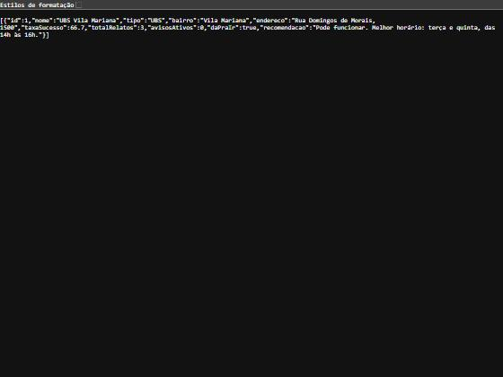
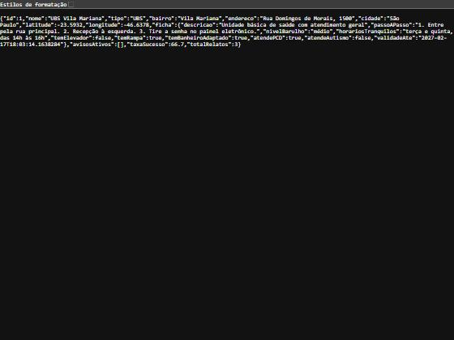

# Dá Pra Ir? — Entrega C# · .NET 8 Web API

**FIAP Global Solution 2026.2 · Grupo FINELT**  
Carlos Henrique (558003) · Mauricio Alves (556214) · Ian Monteiro (558652) · Bruno Silva (550416) · João Hoffmann (550763)

---

## Sobre o projeto

**Dá Pra Ir?** é uma API REST que responde a pergunta: *"esse lugar vai funcionar pra mim?"*  
Voltada para PCDs, famílias atípicas e qualquer pessoa com necessidades específicas de acessibilidade.

---

## Como executar

```bash
cd DaPraIr.API
dotnet run
```

Acesse: `http://localhost:5000/swagger`

O banco SQLite é criado e populado com 3 lugares de exemplo automaticamente no primeiro boot.

---

## Requisitos técnicos demonstrados

| Requisito | Onde está |
|---|---|
| **EF Core 8** com SQLite | `Data/AppDbContext.cs`, `Services/LugarService.cs` |
| **LINQ** com filtros e projeções | `Services/LugarService.cs` — `BuscarPorPerfilAsync` |
| **async/await** | Todos os métodos de `LugarService` e controllers |
| **POO** com herança/interface | `ILugarService` → `LugarService` |
| **Record DTOs** | `DTOs/LugarDto.cs`, `DTOs/AvisoDto.cs`, `DTOs/RelataVisitaDto.cs` |
| **XML Documentation** | `<GenerateDocumentationFile>true</GenerateDocumentationFile>` + `///` nos controllers |
| **Injeção de dependência** | `Program.cs` — `AddScoped<ILugarService, LugarService>()` |
| **Seed Data** | `Data/SeedData.cs` — 3 lugares reais de SP |

---

## Endpoints principais

| Método | Rota | Descrição |
|---|---|---|
| `GET` | `/api/lugares` | Busca por perfil (`usaCadeira`, `sensibilidadeBarulho`, `necessitaAutismo`, `bairro`) |
| `GET` | `/api/lugares/{id}` | Ficha completa do lugar com avisos e taxa de sucesso |
| `GET` | `/api/lugares/{id}/avisos` | Avisos ativos (elevador quebrado, obra, horário especial) |
| `POST` | `/api/lugares/{id}/avisos` | Registra novo aviso comunitário |
| `POST` | `/api/lugares/{id}/relatos` | Relato pós-visita anônimo — "deu certo?" |

---

## Exemplo de chamada

```bash
# Buscar lugares para cadeirante em Pinheiros
curl "http://localhost:5000/api/lugares?usaCadeira=true&bairro=Pinheiros"

# Relatar visita ao lugar 1
curl -X POST "http://localhost:5000/api/lugares/1/relatos" \
  -H "Content-Type: application/json" \
  -d '{"deuCerto": true, "comentario": "Rampa funcionando bem", "necessidadesPerfil": ["cadeira_de_rodas"]}'
```

---

## Estrutura

```
DaPraIr.API/
├── Controllers/
│   ├── LugaresController.cs
│   ├── AvisosController.cs
│   └── RelatosController.cs
├── Data/
│   ├── AppDbContext.cs
│   └── SeedData.cs
├── DTOs/
│   ├── LugarDto.cs         (LugarResumoDto, LugarDetalheDto, FichaDto)
│   ├── AvisoDto.cs         (AvisoDto, CriarAvisoDto)
│   ├── BuscaPerfilDto.cs
│   └── RelataVisitaDto.cs
├── Models/
│   ├── Lugar.cs
│   ├── Ficha.cs
│   ├── Relato.cs
│   └── Aviso.cs
├── Services/
│   ├── ILugarService.cs
│   └── LugarService.cs
├── Program.cs
├── appsettings.json
└── DaPraIr.API.csproj
```

---

## Evidências da aplicação

### Swagger UI — documentação interativa


### GET /api/lugares?usaCadeira=true — busca por cadeirante



```json
[{"id":1,"nome":"UBS Vila Mariana","tipo":"UBS","bairro":"Vila Mariana",
  "taxaSucesso":66.7,"totalRelatos":3,"avisosAtivos":0,
  "daPraIr":true,"recomendacao":"Pode funcionar. Melhor horário: terça e quinta, das 14h às 16h."}]
```

### GET /api/lugares/1 — ficha completa com acessibilidade



### GET /api/lugares?necessitaAutismo=true — busca para autismo


```json
[{"id":3,"nome":"Clínica Sorrir Para Todos","tipo":"Dentista","bairro":"Pinheiros",
  "taxaSucesso":100,"totalRelatos":3,"avisosAtivos":0,
  "daPraIr":true,"recomendacao":"Dá pra ir! Melhor horário: manhã, qualquer dia da semana."}]
```

### POST /api/lugares/1/relatos — relato anônimo pós-visita

```json
// Request
{"deuCerto": true, "comentario": "Rampa funcionando bem", "necessidadesPerfil": ["cadeira_de_rodas"]}

// Response 200 OK
{"id": 9, "deuCerto": true, "mensagem": "Relato registrado. Obrigado por contribuir!"}
```

### GET /api/lugares/2/avisos — avisos ativos após POST

```json
[
  {"id":1,"titulo":"Elevador do acesso B em manutenção","tipo":"elevador",
   "criadoEm":"2026-11-17","expiraEm":"2026-11-20"},
  {"id":2,"titulo":"Elevador principal em manutencao","tipo":"manutencao",
   "criadoEm":"2026-11-17","expiraEm":null}
]
```

---

## ODS atendidas

- **ODS 3** — Saúde e bem-estar  
- **ODS 10** — Redução das desigualdades  
- **ODS 11** — Cidades e comunidades sustentáveis
