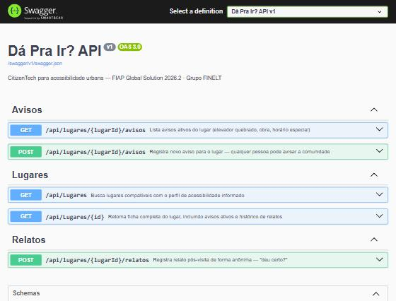
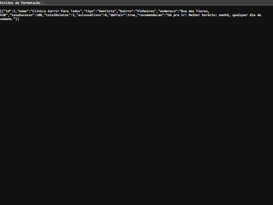

# Dá Pra Ir? — Global Solution 2026.2 · CitizenTech

**FIAP Engenharia de Software · 3º Ano**  
**Grupo FINELT** — Carlos Henrique (558003) · Mauricio Alves (556214) · Ian Monteiro (558652) · Bruno Silva (550416) · João Hoffmann (550763)

---

## Ficha do Projeto — CitizenTech

| Campo | Informação |
|---|---|
| **Nome do projeto** | Dá Pra Ir? |
| **Tagline** | "Vai funcionar pra mim?" — acessibilidade urbana verificada pela comunidade |
| **Grupo** | FINELT |
| **Turma** | 3ESPX |
| **Integrantes** | Carlos (558003), Mauricio (556214), Ian (558652), Bruno (550416), João (550763) |
| **Desafio** | CitizenTech — Tecnologia para cidadania e inclusão |
| **Problema** | 18,6 milhões de PCDs no Brasil não têm como saber, antes de sair de casa, se um lugar terá as condições de acessibilidade de que precisam |
| **Solução** | App que responde "dá pra ir?" com base na ficha de acessibilidade do lugar e nos relatos anônimos de quem visitou antes |
| **Público-alvo** | PCDs (cadeirantes, pessoas com deficiência auditiva/visual), autistas, famílias atípicas, cuidadores |
| **ODS atendidas** | ODS 3 (Saúde e bem-estar), ODS 10 (Redução das desigualdades), ODS 11 (Cidades sustentáveis) |
| **Tecnologias** | .NET 8 Web API (C#), EF Core, SQLite |
| **Repositório** | https://github.com/ianmonteirom/DaPraIrAPI |

---

## Sobre o projeto

Antes de ir a um novo lugar, pessoas com deficiência ou com filhos autistas precisam saber: **tem rampa? O elevador funciona? É barulhento? Qual o melhor horário?**

O **Dá Pra Ir?** reúne essas informações em um único lugar, combinando fichas detalhadas de acessibilidade com relatos anônimos de quem foi antes — sem login, sem burocracia, sem expor diagnóstico.

### Fluxo principal

1. Usuário informa suas necessidades (cadeira de rodas, sensibilidade a barulho, autismo)
2. App retorna lugares ordenados pela taxa de sucesso calculada pelos relatos
3. Cada lugar tem ficha completa: rampa, elevador, banheiro adaptado, nível de barulho, passo a passo de acesso
4. Avisos em tempo real: "elevador quebrado hoje", "obra na entrada"
5. Após a visita: relato anônimo em 1 clique — "deu certo?"

---

## Como executar

```bash
cd csharp/DaPraIr.API
dotnet run
```

Acesse: `http://localhost:5000/swagger`

O banco SQLite é criado e populado com 3 lugares de exemplo automaticamente no primeiro boot.

---

## Requisitos técnicos demonstrados

| Requisito | Onde está |
|---|---|
| **EF Core 8** com SQLite | `csharp/DaPraIr.API/Data/AppDbContext.cs`, `Services/LugarService.cs` |
| **LINQ** com filtros e projeções | `csharp/DaPraIr.API/Services/LugarService.cs` — `BuscarPorPerfilAsync` |
| **async/await** | Todos os métodos de `LugarService` e controllers |
| **POO** com herança/interface | `ILugarService` → `LugarService` |
| **Record DTOs** | `csharp/DaPraIr.API/DTOs/` |
| **XML Documentation** | `<GenerateDocumentationFile>true</GenerateDocumentationFile>` + `///` nos controllers |
| **Injeção de dependência** | `Program.cs` — `AddScoped<ILugarService, LugarService>()` |
| **Seed Data** | `csharp/DaPraIr.API/Data/SeedData.cs` — 3 lugares reais de SP |

---

## Endpoints principais

| Método | Rota | Descrição |
|---|---|---|
| `GET` | `/api/lugares` | Busca por perfil (`usaCadeira`, `sensibilidadeBarulho`, `necessitaAutismo`, `bairro`) |
| `GET` | `/api/lugares/{id}` | Ficha completa do lugar com avisos e taxa de sucesso |
| `GET` | `/api/lugares/{id}/avisos` | Avisos ativos (elevador quebrado, obra, horário especial) |
| `POST` | `/api/lugares/{id}/avisos` | Registra novo aviso comunitário |
| `POST` | `/api/lugares/{id}/relatos` | Relato pós-visita anônimo — "deu certo?" |

---

## Exemplo de chamada

```bash
# Buscar lugares para cadeirante em Pinheiros
curl "http://localhost:5000/api/lugares?usaCadeira=true&bairro=Pinheiros"

# Relatar visita ao lugar 1
curl -X POST "http://localhost:5000/api/lugares/1/relatos" \
  -H "Content-Type: application/json" \
  -d '{"deuCerto": true, "comentario": "Rampa funcionando bem", "necessidadesPerfil": ["cadeira_de_rodas"]}'
```

---

## Evidências da aplicação

### Swagger UI — documentação interativa



### GET /api/lugares?usaCadeira=true — busca por cadeirante


```json
[{"id":1,"nome":"UBS Vila Mariana","tipo":"UBS","bairro":"Vila Mariana",
  "taxaSucesso":66.7,"totalRelatos":3,"avisosAtivos":0,
  "daPraIr":true,"recomendacao":"Pode funcionar. Melhor horário: terça e quinta, das 14h às 16h."}]
```

### GET /api/lugares/1 — ficha completa com acessibilidade


### GET /api/lugares?necessitaAutismo=true — busca para autismo



```json
[{"id":3,"nome":"Clínica Sorrir Para Todos","tipo":"Dentista","bairro":"Pinheiros",
  "taxaSucesso":100,"totalRelatos":3,"avisosAtivos":0,
  "daPraIr":true,"recomendacao":"Dá pra ir! Melhor horário: manhã, qualquer dia da semana."}]
```

### POST /api/lugares/1/relatos — relato anônimo pós-visita

```json
// Request
{"deuCerto": true, "comentario": "Rampa funcionando bem", "necessidadesPerfil": ["cadeira_de_rodas"]}

// Response 200 OK
{"id": 9, "deuCerto": true, "mensagem": "Relato registrado. Obrigado por contribuir!"}
```

### GET /api/lugares/2/avisos — avisos ativos após POST

```json
[
  {"id":1,"titulo":"Elevador do acesso B em manutenção","tipo":"elevador",
   "criadoEm":"2026-11-17","expiraEm":"2026-11-20"},
  {"id":2,"titulo":"Elevador principal em manutencao","tipo":"manutencao",
   "criadoEm":"2026-11-17","expiraEm":null}
]
```

---

## Estrutura

```
DaPraIr.API/
├── Controllers/
│   ├── LugaresController.cs
│   ├── AvisosController.cs
│   └── RelatosController.cs
├── Data/
│   ├── AppDbContext.cs
│   └── SeedData.cs
├── DTOs/
│   ├── LugarDto.cs
│   ├── AvisoDto.cs
│   ├── BuscaPerfilDto.cs
│   └── RelataVisitaDto.cs
├── Models/
│   ├── Lugar.cs
│   ├── Ficha.cs
│   ├── Relato.cs
│   └── Aviso.cs
├── Services/
│   ├── ILugarService.cs
│   └── LugarService.cs
├── Program.cs
├── appsettings.json
└── DaPraIr.API.csproj
```

---

## ODS atendidas

- **ODS 3** — Saúde e bem-estar  
- **ODS 10** — Redução das desigualdades  
- **ODS 11** — Cidades e comunidades sustentáveis
